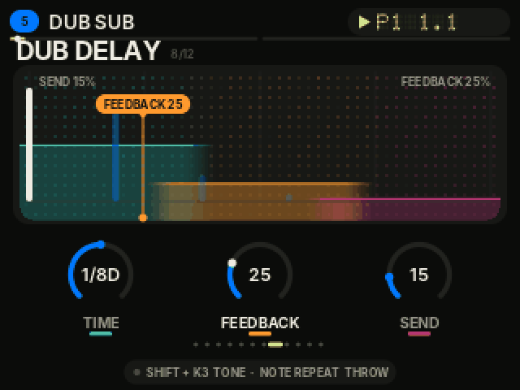
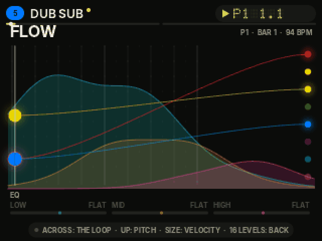
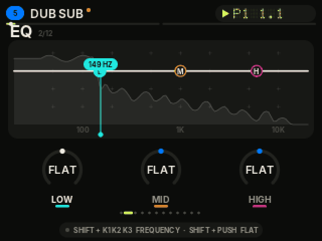
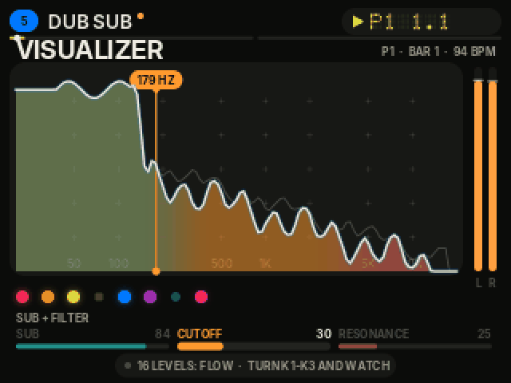

# FM-STEP

**A synth groovebox that runs on the Akai MPC Sample.** Eight tracks of synthesis, a 64-step sequencer, live performance effects and an interface that draws the sound as you play — launched from the SD card next to the stock firmware. Nothing is flashed; the normal MPC is always one exit away.




> **Public beta (v0.9.15).** Tested on one MPC Sample with stock firmware **1.3.0.12** only. Any other firmware simply starts the stock software. Unofficial — not affiliated with or endorsed by Akai Professional or inMusic.

**Press page and detailed build log** (features, screens, test reports, every build with date and time): [`docs/press`](docs/press/index.html) · [PDF report](docs/press/FM-STEP-report.pdf) — on GitHub Pages at `https://<your-user>.github.io/fm-step/press/` once Pages is switched on (Settings → Pages → branch `main`, folder `/docs`).

## What it does

- **Sound:** 23 sound models from Mutable Instruments' Plaits (analog, FM, DX7 banks, chords, modal, drums), a sub oscillator, drive ladder filter, tempo-synced wobble, 3-band EQ per track with movable frequencies and a DJ-style kill, dub tape delay, space echo, reverb, warmth and tape (drift, chorus, glue, saturation, hiss, crackle).
- **Sequencer:** 8 tracks, 16 patterns × up to 64 steps, chains, pitch / velocity / length / ±45 % timing per step, up to 4 parameter locks per step, live recording of notes and knob moves, swing, mutes, live loop length, erase-all with undo.
- **Performance:** 8 fader effects (low pass, high pass, slicer, stutter, space echo, reverb wash, pan, volume) switched from the pads on any screen; two-step STOP (let the echoes ring, then silence).
- **Interface ("infectious controls"):** every parameter page draws its sound — EQ bands over the track's live spectrum, filter response, envelopes, echoes, tape curve — with a flag in the knob's colour that rides along as you turn. Two visualizers on 16 LEVELS (SPECTRUM and FLOW), a loop line on every screen, a mixer and an all-tracks notes view.
- **Safety:** firmware and file-hash checks before launch, a supervisor with watchdog and crash restart, a circuit breaker that falls back to stock, projects autosaved to the card. See [`docs/RECOVERY.md`](docs/RECOVERY.md).




## Install (players)

1. Download `fmstep-0.9.15-sd.zip` from the [Releases](../../releases) page and check it against the `.sha256` file.
2. **Back up your SD card.** Unzip and copy the `autorun` and `FMSTEP` folders to the root of the card.
3. FM-STEP is **off** until you create an empty file named `ENABLE` inside the `FMSTEP` folder.
4. Insert the card and power on. The MPC asks whether to start FM-STEP; choose stock (or do nothing) for the normal MPC.
5. **Exit to stock:** SHIFT + STOP, then STOP. Emergency: hold POWER until off, remove the card, power on.

Full steps: [`docs/INSTALL.md`](docs/INSTALL.md). Controls: [`docs/CONTROLS.md`](docs/CONTROLS.md). Tested firmware: [`docs/COMPATIBILITY.md`](docs/COMPATIBILITY.md).

## Build (developers)

The Go parts (UI app, supervisor) cross-compile anywhere; the C++ sound engine builds natively on arm64 Linux. On an Apple Silicon Mac with Docker Desktop, one command does everything:

```sh
./build-on-mac.sh            # = docker (linux/arm64): make release
# -> dist/fmstep-0.9.15-sd.zip (+ .sha256)
```

Details, the reproducibility notes and the offline renderer (audition the engine on a computer): [`docs/BUILD.md`](docs/BUILD.md).

## How it works

```
MPC boot → stock autorun prompt → launcher (autorun/autorun.sh: firmware + hash checks, copies to RAM)
  → fmstep-supervisor (stops the stock app, watchdog, restores stock on exit / crash)
    → fmstep-app (Go: UI, sequencer state, pads, knobs, screen)
      → fmstep-dsp (C++: Plaits voices, effects, sequencer clock, audio, spectrum)
```

Nothing is written outside RAM and the SD card. Layout: `cmd/` (app, supervisor, lab tools), `internal/` (gfx drawing kit, panel/DRM screen, controls, sequencer, sounds), `dsp/` (sound engine), `launcher/`, `tools/` (packaging, fonts, press art, GIFs), `tests/` (host recovery simulation), `docs/`.

## Credits

Built by **Darren Alexander Cole**, a moving-image and sound artist studying computational media in the Interactive Media & Game Development department at Worcester Polytechnic Institute, with the help of Claude, Anthropic's AI. Inspiration, thanks and open-source components: [`CREDITS.md`](CREDITS.md) and [`THIRD_PARTY.md`](THIRD_PARTY.md).

## Licence

FM-STEP's own code is MIT — see [`LICENSE`](LICENSE). Third-party components keep their own licences (Plaits / Clouds / stmlib: MIT; Inter: SIL OFL 1.1). MPC is a trademark of its owner.
